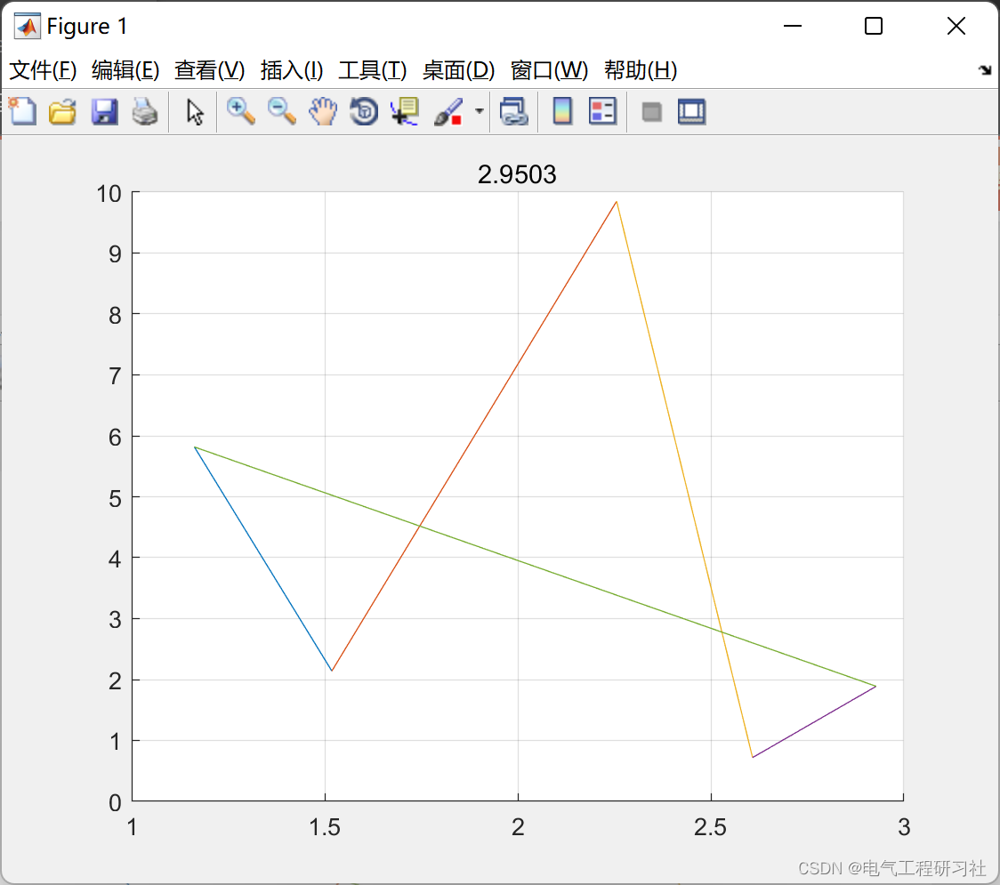
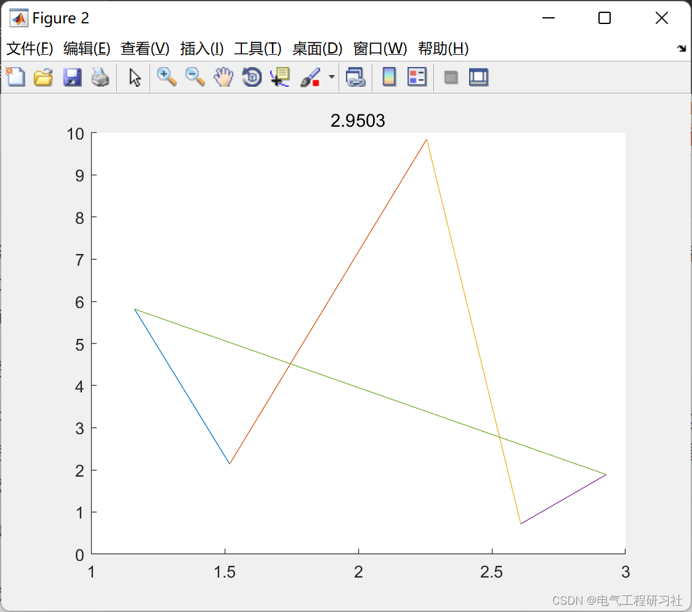

# Discrete Particle Swarm Optimization (DPSO) for Path Planning (Matlab Code Implementation)

​  
📋📋📋This article is organized as follows: ⛳️⛳️⛳️Table of Contents: 1. Discrete Particle Swarm Algorithm 2. MATLAB Code Implementation 3. Final Thoughts
1 Discrete Particle Swarm Optimization Algorithm (DPSO) is an algorithm that updates the positions and velocities of particles in discrete steps, corresponding to continuous functions used in traditional Particle Swarm Optimization Algorithm (PSO).
Generally, after updating the particle positions, discrete point processing is performed on the particles.
For instance, if the discrete points of your particles are integers from 0 to 9. After updating the position of each particle, for example, a random number within the range (0,1), set its value to 0 in the range (0,0.1); set its value to 1 in the range (0.1,0.2); and so on, up to the range (0.9,1). Of course, the initial position values also need to be handled in this manner.
2. The Matlab code implementation is shown in this document, and the complete code can be found in:
Editor
Editor
function main()\n%% Initialize city position vector\ncity_nums=5;\n%% Initialize particle swarm parameters\nparticle_nums=100;\n%% Maximum number of evolutionary generations\nmax_iter=100;\n%% Speed and position update method v = (c1max - i / itermax * (c1max - c1min)) * v + c2(Pbest - Pi) + c3(Pgbest - Pi);\n%% The speed is represented by a matrix of N*N;\n%% The number of particles is particle_nums;\n%% position_Matrix(1:city_nums): current particle path\n%% position_Matrix(city_nums+1): current particle fitness value\n%% position_Matrix(city_nums+2:2*city_nums+1): individual optimal path\n%% position_Matrix(2*city_nums+2): individual optimal fitness value\ncity_position_x_max=10;city_position_y_max=10;city_position=rand(city_nums,2);\ncity_position(:,1)=city_position(:,1)*city_position_x_max;\ncity_position(:,2)=city_position(:,2)*city_position_y_max;\n%% Initialize city distance matrix\ncity_distance=zeros(city_nums,city_nums);\nfor i=1:city_nums\n    for j=1:i\n        city_distance(i,j)=sqrt((city_position(i,1)-city_position(j,1)).^2+(city_position(i,1)-city_position(j,1)).^2);\n        city_distance(j,i)=city_distance(i,j);\n    end\nend\nposition_Matrix=zeros(2*city_nums+2,particle_nums);\nspeed_current_Matrix=zeros(city_nums,city_nums,particle_nums);\nc_x=0.5;c_1_min=0.0;c_1_max=1;c_2=0.4;c_3=0.2;\n%% Initialize the speed and position of the microparticles\nfor i=1:particle_nums\n    position_Matrix(1:city_nums,i)=wGenerate(city_nums);\n    position_Matrix(city_nums+1,i)=calFitness(position_Matrix(1:city_nums,i),city_distance);\n    position_Matrix(city_nums+2:2*city_nums+1,i)=position_Matrix(1:city_nums,i);\n    position_Matrix(2*city_nums+2,i)=position_Matrix(city_nums+1,i);\n    st_Matrix=ones(city_nums).*c_x-eye(city_nums)>rand(city_nums);\n    speed_current_Matrix(:,:,i)=(st_Matrix+st_Matrix')>ones(city_nums);\nend \n[globalBestFitness,thisIndex]=min(position_Matrix(2*city_nums+2,:),[],2);\nglobalBestPath=position_Matrix(city_nums+2:2*city_nums+1,thisIndex);\npathPlot(globalBestPath,city_position)\ntitle(num2str(globalBestFitness));\n%% Iteration process\nfor iter=1:max_iter\n    for i=1:particle_nums\n        PbestLinkM=linkM(position_Matrix(city_nums+2:2*city_nums+1,i));\n        PgbestLinkM=linkM(globalBestPath);\n        v_1_M=PM2VM(speed_current_Matrix(:,:,i),c_1_max-i./max_iter*(c_1_max-c_1_min));\n        v_2_M=PM2VM(sub_M(PbestLinkM,speed_current_Matrix(:,:,i)),c_2);\n        v_3_M=PM2VM(sub_M(PgbestLinkM,speed_current_Matrix(:,:,i)),c_3);\n        v_M=and_M(and_M(v_1_M,v_2_M),v_3_M);\n        for j=1:city_nums\n            for k=j:city_nums\n                if(v_M(j,k)==1)\n                    position_Matrix(1:city_nums,i)=add_M(position_Matrix(1:city_nums,i),[j;k]);\n                end\n            end\n        end\n        position_Matrix(city_nums+1,i)=calFitness(position_Matrix(1:city_nums,i),city_distance);\n        if(position_Matrix(city_nums+1,i)<position_Matrix(2*city_nums+2,i))\n            position_Matrix(city_nums+2:2*city_nums+1,i)=position_Matrix(1:city_nums,i);\n            position_Matrix(2*city_nums+2,i)=position_Matrix(city_nums+1,i);\n        end\n    end\n    [globalBestFitness,thisIndex]=min(position_Matrix(2*city_nums+2,:),[],2);\n    globalBestPath=position_Matrix(city_nums+2:2*city_nums+1,thisIndex);\n%     st_Matrix=ones(city_nums).*c_x-eye(city_nums)>rand(city_nums);\n%     speed_current_Matrix(:,:,thisIndex)=(st_Matrix+st_Matrix')>ones(city_nums);\nend\ngrid on;\nfigure\npathPlot(globalBestPath,city_position)\ntitle(num2str(globalBestFitness));\n  
3. Endnotes: The references to theoretical literature are from online sources, and if any infringement is found, please contact the blogger for removal.

## Images

<!-- PAYMENT_BLOCK -->

## Get this dataset

- Payment link (Stripe): [Buy now](https://buy.stripe.com/3cs8yP7sY87d0vu9AB)
- Payment QR code: 

<!-- /PAYMENT_BLOCK -->
